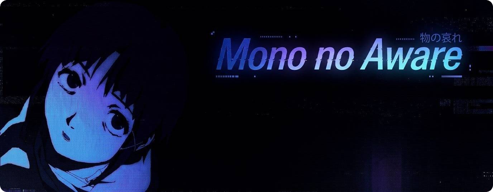

  

### `0x00` // about

Building desktop applications, browser extensions, and developer tools that automate workflows and solve practical problems. Focused on fast, lightweight software, clean interfaces, and solid architecture under the hood.

`contact:` [mononoawares.dev@gmail.com](mailto:mononoawares.dev@gmail.com)

---

### `0x01` // selected work

- **[StreamClip](https://github.com/Mono-no-Awares/StreamClip)** — Chrome & Firefox MV3 extension for instant MP4 clipping from Twitch & Kick streams and VODs (`HLS`, `fMP4`, `mux.js`)
- **[ym-downloader-extension](https://github.com/Mono-no-Awares/ym-downloader-extension)** — Cross-browser Yandex Music downloader with OAuth and client-side `AES-CTR` stream decryption (`320 kbps`)

---

### `0x02` // core stack

- **languages:** typescript · python · rust · c++ · javascript
- **apps & extensions:** electron · react · node.js · tailwind · webextensions api
- **tools & data:** postgresql · docker · linux · git
